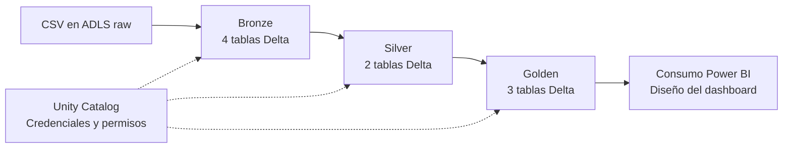
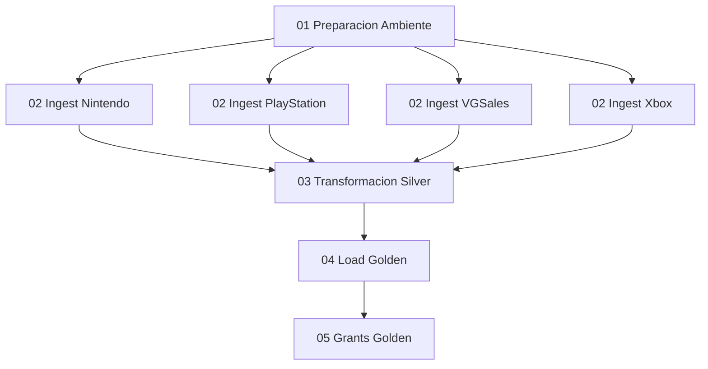

# 🎮 FI Videojuegos — Ingeniería de Datos con Azure Databricks

**De cuatro archivos CSV a un Lakehouse con arquitectura Medallion, gobierno de datos y análisis de ventas.**

Proyecto final del curso de Ingeniería de Datos e IA con Databricks, desarrollado por **Jhonatan Villarreal**. Integra preparación del entorno, ingesta, transformación, carga analítica, permisos, automatización y visualización sobre datos de Nintendo, PlayStation y Xbox.


## Contenido

- [Propósito y preguntas de análisis](#propósito-y-preguntas-de-análisis)
- [Tecnologías](#tecnologías)
- [Fuentes y alcance](#fuentes-y-alcance)
- [Arquitectura Medallion](#arquitectura-medallion)
- [Tablas y claves](#tablas-y-claves)
- [Notebooks y dependencias](#notebooks-y-dependencias)
- [Transformación y calidad](#transformación-y-calidad)
- [Configuración y ejecución](#configuración-y-ejecución)
- [Automatización](#automatización)
- [Seguridad y permisos](#seguridad-y-permisos)
- [Delta Sharing y reversión](#delta-sharing-y-reversión)
- [Dashboard y resultados](#dashboard-y-resultados)
- [Aprendizajes del curso](#aprendizajes-del-curso)
- [Alcance de la entrega](#alcance-de-la-entrega)

## Propósito y preguntas de análisis

El objetivo es construir un proceso reproducible que transforme fuentes heterogéneas de videojuegos en productos de datos organizados, trazables y preparados para análisis. El proyecto reúne información de ventas, plataformas, fechas de lanzamiento, valoraciones y duración de los juegos.

Las preguntas que orientan el análisis son las siguientes.

- ¿Qué familia de consolas acumula más ventas en el conjunto analizado?
- ¿Cómo cambia el liderazgo entre Nintendo, PlayStation y Xbox según el año de lanzamiento?
- ¿Qué registro de juego y plataforma tiene mayores ventas en cada familia y década?
- ¿Cuáles son las plataformas y los géneros con más ventas estimadas?
- ¿Cómo se distribuyen las ventas entre Norteamérica, Europa, Japón y otras regiones?
- ¿Qué proporción de las ventas puede enriquecerse con metadatos y con qué confianza?

En los rankings, **“mejor juego” significa el registro juego–plataforma con mayor venta estimada**. Las valoraciones y las horas de juego se conservan como medidas independientes.

## Tecnologías

| Componente | Aplicación en el proyecto |
|---|---|
| Azure Data Lake Storage Gen2 | Almacenamiento de archivos CSV y datos de las capas |
| Azure Databricks | Desarrollo y ejecución de notebooks |
| Apache Spark y PySpark | Lectura, conversión de tipos, joins, agregaciones y ventanas |
| SQL de Databricks | Preparación de objetos, permisos y consultas analíticas |
| Delta Lake | Persistencia de tablas con control transaccional por tabla |
| Unity Catalog | Organización de catálogo, esquemas, tablas y privilegios |
| Databricks Workflows | Dependencias y ejecución del ETL |
| GitHub y GitHub Actions | Versionamiento, despliegue y activación del Job mediante push |
| Azure Data Factory | Pipeline de actividades DatabricksNotebook |
| Delta Sharing | Notebook adicional para compartir productos de datos |
| Power BI | Destino de consumo analítico y diseño de visualización |

La arquitectura Medallion mejora progresivamente la estructura y la calidad de los datos a través de Bronze, Silver y Gold. En este repositorio, la última capa se denomina `golden`. [Documentación de arquitectura Medallion](https://learn.microsoft.com/en-us/azure/databricks/lakehouse/medallion)

## Fuentes y alcance

La versión final del ETL utiliza cuatro CSV. Los conteos son los esperados para las fuentes validadas por los notebooks.

| Archivo en `raw` | Información principal | Filas esperadas |
|---|---|---:|
| `nintendo.csv` | Metadatos Nintendo con valoraciones Metacritic | 1.026 |
| `playstation.csv` | Metadatos PlayStation con campos IGDB y HLTB | 31.002 |
| `xbox.csv` | Metadatos Xbox con campos IGDB y HLTB | 17.993 |
| `vgsales.csv` | Ventas por título y plataforma, género y editorial | 16.598 |
| **Total de filas de entrada** | **Cuatro fuentes independientes** | **66.619** |

Los nombres Metacritic, IGDB y HLTB identifican el contenido de los CSV suministrados. La ejecución del ETL lee los archivos disponibles en ADLS.

**Interpretación de las cifras**

- Las ventas se expresan en **millones de unidades estimadas**.
- `anio` representa el **año de lanzamiento** del juego.
- Una fila de ventas corresponde a un registro título–plataforma identificado por el `Rank` de la fuente.
- Un título publicado en varias plataformas puede aparecer en varios registros.
- VG Sales contiene otras plataformas, que se conservan en la tabla de hechos bajo `Otras plataformas`.
- El ranking de familias y los líderes por década se restringen a Nintendo, PlayStation y Xbox con año conocido y venta válida.

## Arquitectura Medallion



### Raw

Contiene los cuatro archivos de entrada en el contenedor `raw`. La preparación verifica su existencia y huella SHA-256 antes de procesarlos. El esquema de Unity Catalog llamado `raw` y el contenedor Azure llamado `raw` son objetos distintos dentro de la solución.

### Bronze

Conserva los campos originales de las fuentes como texto y añade trazabilidad mediante `fi_fecha_ingesta` y `fi_archivo_origen`. Cada fuente tiene su notebook de ingesta y su tabla Delta externa.

### Silver

Convierte tipos, normaliza títulos, clasifica familias de plataformas y consolida metadatos. Enriquece las ventas mediante una coincidencia controlada, manteniendo un registro de salida por `rank_venta`.

### Golden

Publica una tabla de hechos y dos productos agregados para análisis. La tabla de hechos conserva el detalle enriquecido. Los otros productos permiten comparar familias por año y consultar los líderes por década.

La preparación declara los objetos de las nueve tablas. Los notebooks posteriores realizan su ingesta, transformación y carga. Los archivos Delta de cada tabla se almacenan en el contenedor correspondiente a su capa.

## Tablas y claves

Catálogo del proyecto, `fi_videojuegos`.

| Capa | Tabla | Granularidad o clave lógica |
|---|---|---|
| Bronze | `fi_br_nintendo` | Fila original del CSV Nintendo |
| Bronze | `fi_br_playstation` | Fila original del CSV PlayStation |
| Bronze | `fi_br_vgsales` | Registro de ventas de la fuente |
| Bronze | `fi_br_xbox` | Fila original del CSV Xbox |
| Silver | `fi_sl_metadatos` | Registro de metadatos con huella `hash_origen` |
| Silver | `fi_sl_ventas_enriquecidas` | Una fila por `rank_venta` |
| Golden | `fi_gd_hechos_ventas` | Una fila por `rank_venta`, con década y cobertura |
| Golden | `fi_gd_ranking_familia_anio` | Una fila por `anio` y `familia` |
| Golden | `fi_gd_mejor_juego_familia_decada` | Una fila por `inicio_decada` y `familia` |

Estas claves describen la granularidad y los controles del código. Las verificaciones de unicidad se realizan con aserciones en los notebooks.

Campos que permiten seguir el procesamiento.

| Campo | Función |
|---|---|
| `rank_venta` | Identifica el registro de ventas y evita multiplicarlo durante el join |
| `titulo_clave` | Título normalizado utilizado para buscar coincidencias |
| `hash_origen` | Huella del registro de metadatos |
| `fi_num_candidatos` | Cantidad de coincidencias candidatas para una venta |
| `confianza_join` | Clasificación de la coincidencia seleccionada |
| `venta_valida` | Identifica ventas aptas para agregación |
| `regiones_conciliadas` | Indica si la suma regional está dentro de la tolerancia |
| `con_metadatos` | Indica disponibilidad de enriquecimiento en Golden |

## Notebooks y dependencias

Los ocho notebooks principales se encuentran juntos dentro de `proceso`.

| Notebook | Responsabilidad |
|---|---|
| `01_Preparacion_Ambiente` | Parámetros, ubicaciones externas, catálogo, esquemas, DDL y validación de CSV |
| `02_Ingest_Nintendo` | Ingesta de `nintendo.csv` a Bronze |
| `02_Ingest_PlayStation` | Ingesta de `playstation.csv` a Bronze |
| `02_Ingest_VGSales` | Ingesta de `vgsales.csv` a Bronze |
| `02_Ingest_Xbox` | Ingesta de `xbox.csv` a Bronze |
| `03_Transformacion_Silver` | Limpieza, consolidación y enriquecimiento |
| `04_Load_Golden` | Tabla de hechos, ranking anual y líderes por década |
| `05_Grants_Golden` | Aplicación condicionada de permisos básicos |



Las cuatro ingestas pueden ejecutarse en paralelo. Silver comienza cuando las cuatro terminan correctamente. Golden depende de Silver y la tarea de permisos se ejecuta al final.

## Transformación y calidad

### Normalización y familias

Se convierten años, fechas, ventas, puntuaciones y horas a sus tipos de destino. Las plataformas se agrupan con reglas explícitas.

| Familia | Códigos de plataforma |
|---|---|
| Nintendo | `NES`, `SNES`, `N64`, `GC`, `Wii`, `WiiU`, `DS`, `3DS`, `GB`, `GBA` |
| PlayStation | `PS`, `PS2`, `PS3`, `PS4`, `PSP`, `PSV` |
| Xbox | `XB`, `X360`, `XOne` |
| Otras plataformas | Los códigos restantes de VG Sales |

### Cruce de ventas y metadatos

La búsqueda combina título normalizado y código de plataforma. Cuando ambos años están disponibles, permite una diferencia de hasta tres años. Si falta alguno, admite una coincidencia con menor confianza.

La selección de candidatos prioriza años conocidos, menor diferencia de año, puntuación disponible y finalmente la huella del registro. Las ventanas de Spark eligen un candidato por `rank_venta`. Las ventas sin coincidencia también se conservan.

| Confianza | Interpretación |
|---|---|
| `ALTA_ANIO_IGUAL` | Coincidencia con el mismo año |
| `MEDIA_DIF_ANIO` | Años compatibles dentro de la tolerancia |
| `BAJA_SIN_ANIO` | Falta un año para contrastar la coincidencia |
| `SIN_COINCIDENCIA` | Venta conservada sin enriquecimiento |

### Controles implementados

- Coincidencia de la huella SHA-256 de cada archivo con la fuente validada.
- Conteos esperados y encabezados de entrada.
- Unicidad de los 16.598 registros de ventas.
- Conservación del conteo y la suma de ventas durante el enriquecimiento.
- Ventas válidas con título normalizado y valor global mayor o igual que cero.
- Comparación entre ventas globales y suma regional, con tolerancia de 0,03 millones.
- Puntuaciones fuera de escala convertidas a nulo en Silver y señaladas con una bandera.
- Conciliación de agregados con la base válida de Golden.
- Verificación del esquema, formato Delta y ruta externa antes de reemplazar datos.

Las escalas IGDB, Metacritic y usuario se mantienen separadas. La cobertura de metadatos se calcula sobre los registros disponibles y se presenta como información de calidad.

## Configuración y ejecución

### Requisitos

1. Workspace Azure Databricks asociado a un metastore de Unity Catalog.
2. Cómputo compatible con Unity Catalog y con SQL scripting utilizado por los notebooks. El entorno mostrado durante el proyecto utiliza Runtime 17.3 LTS y modo Dedicated.
3. Acceso a ADLS Gen2 y una Storage Credential autorizada.
4. Contenedores de almacenamiento preparados y cuatro CSV en `raw`.
5. Privilegios para crear o utilizar las ubicaciones, el catálogo, los esquemas y las tablas correspondientes.
6. Usuarios y grupos existentes antes de aplicar los grants.

La preparación SQL crea los objetos del proyecto en un entorno ya aprovisionado. El metastore y el cómputo se configuran desde la administración de la plataforma.

### Parámetros

| Parámetro | Valor utilizado | Significado |
|---|---|---|
| `storageName` | `adlsmardata1412jmvcc` | Cuenta ADLS Gen2 |
| `catalogo` | `fi_videojuegos` | Catálogo del proyecto |
| `storageCredential` | `credential` | Credencial registrada en Unity Catalog |
| `container_metastore` | `metastore` | Contenedor configurado para la ubicación administrada del catálogo |
| `carpeta_proyecto` | `fi_videojuegos_jmcc` | Prefijo de las rutas del proyecto |
| `raw_subdir` | Cadena vacía | CSV directamente en la raíz de `raw` |
| `aplicar_grants` | `false` en los notebooks | Activa la aplicación de permisos cuando se envía `true` |

El nombre efectivo del contenedor de metastore debe coincidir con el almacenamiento autorizado en el workspace de destino. Los valores anteriores corresponden a los archivos de la entrega y pueden requerir ajuste al desplegar en otro entorno.

Ejemplos de rutas del proyecto.

```text
abfss://raw@adlsmardata1412jmvcc.dfs.core.windows.net/vgsales.csv
abfss://bronze@adlsmardata1412jmvcc.dfs.core.windows.net/fi_videojuegos_jmcc/fi_br_vgsales
abfss://silver@adlsmardata1412jmvcc.dfs.core.windows.net/fi_videojuegos_jmcc/fi_sl_ventas_enriquecidas
abfss://golden@adlsmardata1412jmvcc.dfs.core.windows.net/fi_videojuegos_jmcc/fi_gd_hechos_ventas
```

### Primera ejecución

1. Importar el DBC del proyecto o sincronizar los notebooks desde GitHub.
2. Revisar parámetros, nombres de contenedores y permisos del entorno.
3. Colocar los cuatro CSV con sus nombres exactos en la ubicación `raw` configurada.
4. Ejecutar `01_Preparacion_Ambiente`.
5. Ejecutar las cuatro ingestas y comprobar sus conteos.
6. Ejecutar `03_Transformacion_Silver` y revisar confianza y cobertura.
7. Ejecutar `04_Load_Golden` y comprobar las conciliaciones.
8. Ejecutar `05_Grants_Golden` con `aplicar_grants=true` cuando corresponda aplicar los privilegios.
9. Consultar las tres tablas Golden y preparar el consumo analítico.

Las cargas usan reemplazo de datos sobre los destinos del proyecto. Delta ofrece atomicidad por escritura de tabla. El flujo completo contiene varias escrituras, por lo que una falla intermedia puede dejar capas en distintos estados de actualización. Después de corregir la causa, se repite la etapa afectada y sus dependencias.

## Automatización

### GitHub Actions y Databricks Workflows

El workflow adaptado a FI Videojuegos está configurado para activarse con un push a `main`. Exporta los notebooks desde el workspace de origen, los importa en producción, busca el cómputo por nombre y crea o actualiza el Job antes de solicitar su ejecución.

| Elemento | Configuración de la entrega |
|---|---|
| Ruta de origen | `/Workspace/Users/jhonatavillarreal141210@outlook.com/CICDVIDEOGAMES/proceso` |
| Ruta de destino | `/FI_Proyecto_Videojuegos_PROD/proceso` |
| Job | `WF_FI_VIDEOJUEGOS_PROD` |
| Nombre de cómputo buscado | `ClusterSD` |
| Activación | Push a `main` |

El ID del clúster se obtiene en el workspace destino a partir del nombre `ClusterSD`. Si se sustituye el workspace de producción, deben actualizarse sus secretos de destino. La cuenta que ejecuta el Job debe tener acceso al cómputo Dedicated y a los objetos de Unity Catalog.

La configuración del Job enviada por el YAML establece `aplicar_grants=true`, aunque los widgets de los notebooks tienen `false` como valor inicial para la ejecución manual. Los parámetros enviados por el Job determinan el comportamiento de esa ejecución.

Secretos de GitHub utilizados por el despliegue.

```text
DATABRICKS_ORIGIN_HOST
DATABRICKS_ORIGIN_TOKEN
DATABRICKS_DEST_HOST
DATABRICKS_DEST_TOKEN
```

Los tokens se configuran como secretos de GitHub Actions. La ruta de los notebooks identifica código del workspace, mientras que las rutas `abfss` identifican almacenamiento de datos. [Secretos de GitHub Actions](https://docs.github.com/en/actions/how-tos/write-workflows/choose-what-workflows-do/use-secrets)

### Azure Data Factory

El pipeline `PL_FI_VIDEOJUEGOS` utiliza actividades `DatabricksNotebook` y el Linked Service `ls_adb`. Sigue las dependencias de preparación, ingestas, transformación, carga y grants.

Las rutas de `notebookPath` deben corresponder al workspace configurado en el Linked Service. Los parámetros `baseParameters` se envían con valores de texto. GitHub Actions y Data Factory son mecanismos disponibles para activar el procesamiento, y su configuración debe evitar ejecuciones superpuestas sobre los mismos destinos.

## Seguridad y permisos

Unity Catalog centraliza el acceso al catálogo y a las tablas. El notebook final aplica permisos básicos a los grupos y usuarios previamente registrados.

| Grupo | Acceso definido en el notebook |
|---|---|
| `Nintendo` | Uso del catálogo y esquema Bronze, consulta de `fi_br_nintendo` |
| `Play` | Uso del catálogo y esquema Bronze, consulta de `fi_br_playstation` |
| `Xbox` | Uso del catálogo y esquema Bronze, `SELECT` y `MODIFY` sobre `fi_br_xbox` |
| `PC` | Uso del catálogo y esquema Golden, consulta de `fi_gd_ranking_familia_anio` |
| `Comunidad` | `BROWSE` sobre el catálogo |

El código también concede esos privilegios a cinco identidades individuales ya creadas. Los grants están condicionados por `aplicar_grants`. Los permisos de navegación, consulta y modificación tienen alcances distintos.

La configuración de privilegios de Unity Catalog complementa los permisos de Azure sobre el almacenamiento y la identidad usada por la Storage Credential. Los archivos del repositorio deben publicarse sin credenciales de acceso.

## Delta Sharing y reversión

### Delta Sharing

El notebook SQL adicional `5. DeltaSharing.sql` prepara `fi_videojuegos_share` con dos tablas.

- `fi_videojuegos.silver.fi_sl_ventas_enriquecidas`.
- `fi_videojuegos.golden.fi_gd_ranking_familia_anio`.

Incluye acciones de vista previa, preparación y concesión de acceso. Para conceder acceso requiere un recipient existente y una confirmación explícita. Su ejecución es independiente de los ocho notebooks del ETL principal.

### Reversión

El notebook `1. Drop-Medallion.sql` permite revisar y retirar los registros de las nueve tablas del catálogo después de verificar tipo, formato y ruta. La operación exige confirmación explícita.

Al eliminar una tabla externa, Unity Catalog retira su registro y conserva los archivos de almacenamiento. El notebook de reversión se reserva para operaciones controladas sobre el proyecto. [Objetos administrados y externos](https://learn.microsoft.com/en-us/azure/databricks/data-governance/unity-catalog/managed-versus-external)

## Dashboard y resultados

El diseño analítico organiza los resultados en siete secciones.

1. Panorama ejecutivo con ventas, volumen de registros y líderes.
2. Comparación de familias y mejores registros por década.
3. Plataformas con más ventas estimadas.
4. Ventas por género.
5. Comparación de cohortes por año de lanzamiento.
6. Juego más vendido de cada familia.
7. Ranking anual de Nintendo, PlayStation y Xbox.


*Vista previa del diseño elaborada con cálculos locales sobre el CSV de ventas. La imagen ilustra el producto analítico propuesto.*

### Resultados calculados para el prototipo

Se utilizaron registros con venta válida, año conocido y familia Nintendo, PlayStation o Xbox.

| Indicador | Resultado local |
|---|---:|
| Registros juego–plataforma del alcance comparado | 14.985 |
| Ventas globales estimadas | 8.395,76 millones |
| PlayStation | 3.541,64 millones |
| Nintendo | 3.491,36 millones |
| Xbox | 1.362,76 millones |
| Registro con mayor venta | Wii Sports para Wii, 82,74 millones |

PlayStation acumula la mayor venta dentro de este alcance, mientras que Wii Sports es el registro individual con mayor volumen. Estos resultados dependen del conjunto histórico utilizado y de los filtros descritos.

### Archivos de Power BI

| Archivo | Uso |
|---|---|
| `01_Tema_PowerBI.json` | Paleta y tipografía que se importan como tema |
| `02_Tablas_Videojuegos.json` | Tres conjuntos de datos locales para probar el análisis |
| Imágenes PNG | Vistas previas y maquetas de las siete secciones |

El JSON local reconstruye campos de ventas y agregaciones. La tabla de hechos en Databricks dispone además del enriquecimiento generado en Silver. Las maquetas de la interfaz llevan una identificación de vista previa.

Para aplicar el tema, se utiliza **Vista → Temas → Examinar temas**. El tema configura la apariencia del informe y los visuales se construyen en Power BI. Para cargar los datos locales se utiliza **Obtener datos → JSON**, convirtiendo cada lista de registros en una consulta de Power Query. [Temas de informes Power BI](https://learn.microsoft.com/power-bi/create-reports/desktop-report-themes)

Para consultar producción, el conector Azure Databricks requiere el Server hostname, HTTP Path y una autenticación válida. Desde el navegador del conector se seleccionan las tres tablas Golden del catálogo del proyecto. [Conexión de Power BI a Azure Databricks](https://learn.microsoft.com/en-us/azure/databricks/partners/bi/power-bi/desktop)

En el modelo analítico, las tres tablas representan granularidades distintas. Las dimensiones compartidas de familia, año y década permiten construir filtros sin sumar nuevamente las ventas de los hechos y sus agregados.

### Consultas de referencia

```sql
-- Ventas comparables por familia, en millones de unidades estimadas
SELECT familia, SUM(ventas_globales) AS ventas_millones
FROM fi_videojuegos.golden.fi_gd_hechos_ventas
WHERE venta_valida
  AND anio IS NOT NULL
  AND familia IN ('Nintendo', 'PlayStation', 'Xbox')
GROUP BY familia
ORDER BY ventas_millones DESC;
```

```sql
-- Familias líderes de cada año de lanzamiento, incluidos posibles empates
SELECT anio, familia, ventas_globales_millones, participacion_pct
FROM fi_videojuegos.golden.fi_gd_ranking_familia_anio
WHERE puesto = 1
ORDER BY anio, familia;
```

```sql
-- Líderes por familia y década
SELECT decada, familia, mejor_juego, plataforma,
       ventas_millones, segundo_juego, supero_al_segundo_pct
FROM fi_videojuegos.golden.fi_gd_mejor_juego_familia_decada
ORDER BY inicio_decada, familia;
```

## Aprendizajes del curso

El proyecto integra los conceptos trabajados en el curso dentro de un caso de datos reproducible.

| Competencia | Evidencia en la solución |
|---|---|
| Diseño de un Lakehouse | Separación de almacenamiento y procesamiento por capas |
| Arquitectura Medallion | Raw, cuatro Bronze, dos Silver y tres Golden |
| Procesamiento distribuido | DataFrames, joins, agregaciones y ventanas de Spark |
| SQL y definición de esquemas | Preparación del catálogo, esquemas y tablas externas |
| Calidad de datos | Huellas, conteos, tipos, conciliación y confianza del cruce |
| Parametrización | Widgets y parámetros de tareas |
| Gobierno y seguridad | Storage Credential, ubicaciones externas y grants |
| Orquestación | Dependencias en Databricks Workflows y Data Factory |
| Versionamiento y despliegue | GitHub Actions y separación de origen y producción |
| Compartición de datos | Notebook de Delta Sharing |
| Operación del ciclo de vida | Notebook de reversión con revisión previa |
| Comunicación de resultados | Consultas analíticas y diseño de dashboard |

La aportación del proyecto al componente de IA del curso consiste en preparar datos trazables y estructurados que puedan alimentar análisis posteriores. El alcance implementado comprende ingeniería y analítica descriptiva.

## Alcance de la entrega

- El DBC final define ocho notebooks y nueve tablas Delta externas.
- Los notebooks incluyen controles de entrada, validación de esquema, conciliación y preservación de la granularidad.
- El estudiante reportó la ejecución del ETL en su entorno durante el desarrollo.
- La automatización está expresada en los archivos de GitHub Actions y Azure Data Factory. Su estado operativo se verifica mediante los registros de cada ejecución.
- Los resultados numéricos del dashboard con el proyecto
- Las imágenes muestran diseños y maquetas del informe. La conexión real de Power BI se acredita con la ejecución y las capturas obtenidas en esa herramienta.

Los datos pueden contener años atípicos, valores ausentes y coberturas desiguales entre plataformas. El procesamiento conserva información de calidad para interpretar los resultados. Una actualización de las fuentes requiere revisar huellas, conteos y reglas de validación.

## Estructura de publicación

La siguiente organización reúne los componentes preparados durante el proyecto. Las extensiones de los notebooks dependen de su formato de exportación.

```text
CICDVIDEOGAMES/
├── certificaciones/
│   ├── Academy Accreditation - Generative AI…
│   └── Credenciales.txt
├── dashboard/
│   ├── 01_Tema_PowerBI.json
│   └── 02_Tablas_Videojuegos.json
├── datasets/
│   ├── nintendo.csv
│   ├── playstation.csv
│   ├── vgsales.csv
│   └── xbox.csv
├── delta-sharing/
│   └── 5. DeltaSharing
├── evidencias/
│   ├── 01_Panorama.png
│   ├── 02_Familias.png
│   ├── 03_Plataformas.png
│   ├── 04_Generos.png
│   ├── 05_Anos.png
│   ├── 06_Lideres.png
│   ├── 07_Ranking.png
│   ├── 2 entornos.png
│   ├── Containers.png
│   ├── DATA FACTORY.png
│   ├── Data factory Final.png
│   ├── Manage Identity.png
│   ├── NuevoCatalogoPanle de control.png
│   ├── ResourceGroups.png
│   └── Usuarios y Grupos Creados.png
├── proceso/
│   ├── 01_Preparacion_Ambiente
│   ├── 02_Ingest_Nintendo
│   ├── 02_Ingest_PlayStation
│   ├── 02_Ingest_VGSales
│   ├── 02_Ingest_Xbox
│   ├── 03_Transformacion_Silver
│   ├── 04_Load_Golden
│   └── 05_Grants_Golden
├── reversion/
│   └── 1. Drop-Medallion
├── seguridad/
│   └── 05_Grants_Golden
└── README.md
```

| Carpeta | Contenido y propósito |
|---|---|
| `certificaciones` | Archivos relacionados con la formación y las acreditaciones del curso |
| `dashboard` | Tema visual de Power BI y datos locales de las tres tablas analíticas en formato JSON |
| `datasets` | Cuatro archivos CSV utilizados como fuentes del proyecto |
| `delta-sharing` | Notebook SQL para preparar la compartición de tablas del proyecto |
| `evidencias` | Imágenes de infraestructura, configuración y vistas previas del dashboard |
| `proceso` | Ocho notebooks que componen el flujo de preparación, ingesta, transformación, carga y permisos |
| `reversion` | Notebook SQL para revisar y retirar los registros de las tablas del proyecto |
| `seguridad` | Copia del notebook de permisos básicos sobre los objetos de Unity Catalog |
| `README.md` | Documentación del proyecto, arquitectura, configuración y ejecución |

``
## Autor y contexto académico

**Jhonatan Villarreal** · Proyecto final de Ingeniería de Datos e IA con Databricks.

El trabajo adapta el flujo de preparación, ingesta, transformación, carga y permisos estudiado en clase al dominio de videojuegos, con catálogo, fuentes, tablas y reglas de negocio propios.
